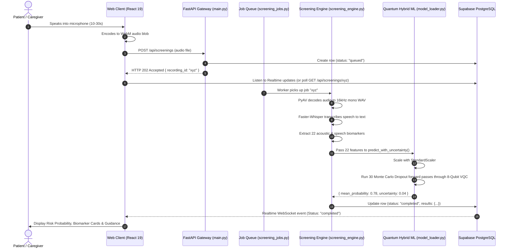

# NeuroSense — Comprehensive Project Guide & Technical Architecture

Welcome to **NeuroSense**! This guide is designed as a complete, beginner-friendly technical manual for developers, teammates, and hackathon presenters. It explains what this project does, how its code is organized, how its machine learning models function, and how every part of the system communicates.

---

## 1. Project Overview

### What is this project?
**NeuroSense** is an AI-powered neurological health monitoring and clinical decision-support platform. It analyzes vocal patterns, speech acoustic stability, motor-phonetic markers, and cognitive responses to assess neurological impairment risks (such as cognitive decline, motor-speech dysregulation, and neurological vulnerability associated with seizure tendencies and neurological disorders).

### What problem does it solve?
Neurological assessments (such as EEG studies, clinical brain imaging, and comprehensive neurological batteries) are typically expensive, inaccessible in rural or non-hospital settings, and only performed after severe symptoms or acute episodes have already occurred. 

NeuroSense provides a **non-invasive, accessible, and fast pre-screening tool**:
- A patient speaks for 10 to 60 seconds (describing a visual scene, performing vocal phonation, or completing word fluency tasks).
- The system automatically extracts vocal, acoustic, and language biomarkers.
- A hybrid quantum-classical neural network evaluates these biomarkers and provides a risk probability score with uncertainty estimates.
- Results are saved offline or synced to the cloud, allowing neurologists to review longitudinal trends.

> **Medical Clarification:** NeuroSense is a **decision-support screening tool**, explicitly **not** an automated diagnostic medical device. It flags variations for clinical follow-up rather than replacing a doctor.

### How does a user use it?
1. The user opens the web application or mobile app.
2. The user is greeted by an intuitive, elderly-friendly interface available in multiple languages (English, Hindi, Bengali, etc.).
3. The user starts a screening session and records their voice:
   - **Scene Description Task:** Describing what is happening in a reference scene.
   - **Sustained Phonation Task:** Saying "Ahhhh" for 5 seconds to test vocal cord motor stability.
   - **Verbal Fluency Task:** Naming as many animals or items as possible in 60 seconds.
4. The user can also play non-diagnostic **Cognitive Engagement Games** (Memory Treasure, Logic Puzzle, Selective Attention, Speed Visualisation) to keep their mind active.
5. Once submitted, the app shows the real-time processing status (`uploading → transcribing → extracting → scoring → completed`).
6. The user and their caregiver can review their historical trends, while doctors can inspect detailed biomarker radar charts and download clinical PDF reports.

---

## 2. Complete Folder Structure

Below is an overview of how the repository is structured:

```
NeuroSense/
├── android/                 # Capacitor wrapper converting the web app into an Android APK
├── backend/                 # Python FastAPI backend & Quantum Machine Learning pipeline
│   ├── database/            # Supabase PostgreSQL schema and migration scripts
│   ├── models/              # Saved model weights, scalers, imputers, and evaluation JSONs
│   ├── uploads/             # Temporary folder storing uploaded audio recordings
│   ├── main.py              # FastAPI application server and HTTP endpoints
│   ├── model_loader.py      # Quantum-Classical Hybrid model definition and loader
│   ├── screening_engine.py  # Orchestrator for Whisper ASR and biomarker extraction
│   ├── screening_jobs.py    # Background task worker and asynchronous queue
│   ├── speech_features.py   # Acoustic biomarker extractor (librosa, Parselmouth Praat)
│   ├── task_scoring.py      # Clinical battery scoring (Fluency, Phonation, Recall)
│   ├── explainability.py    # Quantum gradient attribution engine
│   └── supabase_service.py  # Cloud database and file storage connector
├── mobile/                  # Native cross-platform Flutter mobile application
│   ├── android/             # Native Android project configuration for Flutter
│   ├── lib/                 # Flutter source code (screens, services, models)
│   └── test/                # Flutter unit and widget test suite
├── src/                     # React 19 + Vite web frontend
│   ├── components/          # Reusable UI components, cognitive games, and modals
│   │   ├── alois/           # Patient wellness shell (Home, Care, Check-in, Appointments)
│   │   └── cognitiveGames/  # 4 interactive brain engagement games
│   ├── services/            # Frontend services (IndexedDB, API, Audio, Supabase)
│   ├── types/               # TypeScript interfaces and state types
│   ├── App.tsx              # Main web application entry and Doctor Clinical Hub
│   ├── index.css            # Global styling and Tailwind CSS v4 setup
│   └── main.tsx             # React DOM root render
├── public/                  # Static assets (logos, PWA icons, manifest.json)
├── docs/                    # Technical architecture, provenance audits, benchmarks
├── final.ipynb              # Jupyter notebook containing the complete ML training pipeline
├── package.json             # Root web project dependencies and scripts (pnpm)
├── vite.config.ts           # Vite build configuration with Tailwind CSS v4 plugin
└── README.md                # Main repository documentation
```

---

## 3. Important Files and Their Functions

| File / Folder | What it does | Why it is used |
|---|---|---|
| **Frontend Core** | | |
| `src/App.tsx` | Main React application state machine (~10,000 lines) containing the screening UI, navigation, design tokens, multilingual translation dictionary, and the Doctor Clinical Hub. | Acts as the central nervous system of the web client; coordinates all screens and patient/doctor transitions. |
| `src/components/alois/AloisContainer.tsx` | Manages the 5 bottom navigation tabs for the patient phone view (Home, Daily Care, Check-in, Appointments, Profile). | Enforces clean separation between patient wellness views and clinician inspection tables. |
| `src/components/alois/AloisHomeDashboard.tsx` | Displays greeting, next scheduled check-in, recent assessment status, and primary action buttons. | Gives patients an encouraging, accessible dashboard upon launching the app. |
| `src/components/alois/AloisDailyCheckIn.tsx` | Conducts interactive daily orientation check-ins (date, time, location, memory recall). | Enables tracking within-person cognitive and motor variations over days and weeks. |
| `src/components/cognitiveGames/` | Contains 4 brain games: Logic Puzzle, Memory Treasure, Selective Attention, and Speed Visualisation. | Provides engaging, non-clinical cognitive exercises for patients. |
| `src/components/ApkDownloadModal.tsx` | Modal dialog allowing users to scan a QR code or download the native Android APK. | Enables patients without modern browser support to install the app directly on their phones. |
| **Frontend Services** | | |
| `src/services/apiConfig.ts` | Resolves the backend API URL (production Render cloud, local development IP, or Android emulator). | Allows dynamic API URL switching without recompiling the frontend code. |
| `src/services/screeningJob.ts` | Dispatches screening audio uploads and manages real-time status monitoring via WebSockets or polling. | Prevents frontend HTTP timeouts during long ML processing jobs. |
| `src/services/audioRecorder.ts` | Web Audio API wrapper that handles microphone recording, live audio level analysis, and WebM encoding. | Captures crisp, uncompressed patient vocal recordings in the browser. |
| `src/services/db.ts` | Client-side IndexedDB wrapper using the `idb` library for offline caching of screenings, audio blobs, and notes. | Guarantees that the app remains functional in rural areas with poor internet connectivity. |
| `src/services/supabase.ts` | Connects the web client to Supabase Authentication, PostgreSQL tables, and Realtime subscriptions. | Handles cloud data persistence and multi-device synchronization. |
| `src/services/report.ts` | Generates downloadable, printable clinical PDF and HTML screening reports for doctors. | Translates raw AI model probabilities and biomarkers into doctor-friendly clinical summaries. |
| **Backend Core** | | |
| `backend/main.py` | FastAPI application entry point with CORS settings, routing, health probes, and API endpoints. | Serves HTTP requests from web and mobile clients. |
| `backend/screening_jobs.py` | Implements an asynchronous job queue with a single worker thread and stage tracking. | Prevents memory overflows (OOM) on low-resource cloud servers (512 MB RAM limit). |
| `backend/screening_engine.py` | Pipeline coordinator that runs Faster-Whisper ASR, extracts biomarkers, and calls the ML model. | Connects speech decoding, feature engineering, and quantum ML inference into one workflow. |
| `backend/speech_features.py` | Audio signal processing module extracting 22 acoustic features (pitch $F_0$, jitter, shimmer, HNR, pauses). | Converts raw sound waves into mathematical numbers representing vocal motor stability. |
| `backend/audio_analyzer.py` | PyAV-based audio decoder that normalizes arbitrary audio formats (WebM, M4A, WAV, MP3) to 16 kHz mono. | Ensures consistent audio quality and prevents decoding errors across different phone models. |
| `backend/model_loader.py` | PyTorch + PennyLane module that defines and executes the 8-qubit Quantum-Classical Hybrid model. | Loads model weights (`.pt`), scaler (`.pkl`), and runs 30 Monte Carlo Dropout passes. |
| `backend/task_scoring.py` | Evaluates standardized clinical tasks (Verbal Fluency, Phonation stability, Story Recall). | Provides objective clinical reference metrics alongside the AI model score. |
| `backend/explainability.py` | Calculates quantum gradient attributions for each input biomarker. | Explains *why* the AI assigned a particular risk score (clinical explainability). |
| `backend/supabase_service.py` | Server-side Supabase client for reading/writing screening jobs and uploading audio recordings. | Manages backend database operations and cloud bucket file storage. |
| **Machine Learning & Data** | | |
| `final.ipynb` | The master Jupyter training notebook containing dataset discovery, RFECV selection, scaling, and hybrid training. | Documents the complete experimental history and training pipeline that produced the model checkpoint. |
| `backend/models/` | Folder containing `swarsanket_quantum_hybrid_model.pt`, scalers, imputers, and feature lists. | Holds the production-ready weights and parameters needed for instant inference. |
| `backend/benchmark_baselines.py`| Benchmark harness comparing the Quantum Hybrid model against Classical baselines (SVM, Random Forest, XGBoost). | Proves whether quantum machine learning provides higher sensitivity and specificity than classical ML. |
| **Mobile & Native** | | |
| `mobile/lib/main.dart` | Main entry point for the standalone Flutter mobile app. | Initializes Flutter widgets, local storage, and routes. |
| `android/` | Capacitor Android workspace wrapping the web `dist/` bundle into an installable Android APK. | Provides a lightweight native Android wrapper for immediate mobile distribution. |
| **Config & Deployment** | | |
| `package.json` | Web application package manifest managed with `pnpm`. | Defines frontend dependencies, build scripts, and metadata. |
| `vite.config.ts` | Vite configuration featuring Tailwind CSS v4 and React plugins. | Compiles TypeScript and bundles frontend assets for production. |
| `backend/Dockerfile` | Docker container blueprint for the FastAPI backend with CPU-optimized PyTorch and Whisper. | Enables deployment to Render, AWS, or any Docker container host. |
| `vercel.json` | Vercel deployment configuration with reverse-proxy rewrites routing `/api/*` to Render. | Eliminates cross-origin CORS issues in production. |

---

## 4. Technology Stack

| Technology | Where it is used | What it does |
|---|---|---|
| **React 19** | `src/` (Web Frontend) | The core component-based user interface library that renders the web app. |
| **TypeScript** | `src/` & `backend/` | Adds strict type safety, eliminating runtime type errors across the frontend codebase. |
| **Vite 6** | `vite.config.ts` | High-speed frontend build tool and local development server. |
| **Tailwind CSS v4** | `src/index.css` | Modern utility-first CSS framework for responsive and clean healthcare styling. |
| **FastAPI** | `backend/main.py` | Fast, lightweight Python web framework for building REST APIs with automatic OpenAPI docs. |
| **PyTorch (v2.x)** | `backend/model_loader.py` | Deep learning framework used for the classical encoder, decoder, and training pipeline. |
| **PennyLane** | `backend/model_loader.py` | Quantum machine learning library used to define and execute the 8-qubit Variational Quantum Circuit (VQC). |
| **Faster-Whisper** | `backend/screening_engine.py` | Highly optimized implementation of OpenAI's Whisper model for speech-to-text transcription on CPU. |
| **PyAV** | `backend/audio_analyzer.py` | Direct Python bindings for FFmpeg used for container decoding and audio resampling to 16 kHz mono. |
| **librosa & Parselmouth** | `backend/speech_features.py` | Audio and acoustic analysis tools (Praat wrapper) used to extract pitch ($F_0$), jitter, and shimmer. |
| **spaCy** | `backend/speech_features.py` | Natural Language Processing (NLP) library used to extract grammatical and linguistic speech markers. |
| **Scikit-Learn** | `backend/model_loader.py` | Provides data preprocessing tools (`StandardScaler`, `SimpleImputer`) and baseline comparison models. |
| **Flutter / Dart** | `mobile/` | Cross-platform framework providing a secondary native mobile application. |
| **Capacitor** | `android/` | Cross-platform runtime turning web apps into native Android applications with native device access. |
| **Supabase** | `backend/` & `src/` | Backend-as-a-Service providing PostgreSQL, Realtime WebSocket sync, and encrypted file storage. |
| **IndexedDB (`idb`)** | `src/services/db.ts` | In-browser NoSQL database enabling complete offline-first operation. |
| **Docker** | `backend/Dockerfile` | Containerization tool packaging the backend server, Python dependencies, and ML models. |

---

## 5. AI/ML Model Explained

The machine learning core of NeuroSense is one of its most innovative elements. Below are the 12 key facts:

### 1. Which AI/ML model is used?
A **Quantum-Classical Hybrid Neural Network** (Classical Neural Network + Variational Quantum Circuit).

### 2. Is it CNN, ANN, Random Forest, SVM, or something else?
It is **not** a traditional CNN or pure tree model (like Random Forest or XGBoost). It is an **ANN-VQC Hybrid**:
- An Artificial Neural Network (Classical Encoder) feeds into a Parameterized Quantum Circuit (VQC), which then feeds into a Classical Decoder.

### 3. What is the model's actual name and architecture?
**NeuroSense 8-Qubit Quantum-Classical Hybrid Model (`QHybridNet`)**:
```
Input: 22 Biomarkers
  │
  ▼
[Classical Encoder]
  Dense Layer (22 → 16) + BatchNorm + ReLU + Dropout(0.2)
  Dense Layer (16 → 8)  + BatchNorm + ReLU + Dropout(0.2)
  │
  ├────────────────────────────────────────────────┐ (Residual Skip Path)
  ▼                                                │
[8-Qubit Quantum Circuit (PennyLane VQC)]          │
  AngleEmbedding (Rotation = Y across 8 qubits)    │
  BasicEntanglerLayers (3 layers × 8 qubits)       │
  Measurement: Expectation values <Z_i> (8 values) │
  │                                                │
  ▼                                                │
[Concatenation: 8 Quantum outputs + 8 Skip features = 16 features]
  │
  ▼
[Classical Decoder]
  Dense Layer (16 → 8) + ReLU + Dropout(0.2)
  Dense Layer (8 → 1)  + Sigmoid
  │
  ▼
Output: Neurological Risk Probability (0.0 to 1.0)
```

### 4. Which dataset is used?
The model was trained on an acoustic/speech cognitive dataset containing **468 recordings** across Chinese ASR transcriptions (from Xunfei/iFlytek, Tencent, and AliYun engines) paired with cognitive status labels.

### 5. Where does the dataset come from?
The dataset consists of 6 CSV files (`xunfei_train_asr.csv`, `xunfei_test_asr.csv`, `Tencent_train_asr.csv`, etc.) representing clinical speech task evaluations (Cookie Theft Picture description task).

### 6. What input does the model accept?
The model accepts a vector of **exactly 22 normalized clinical features**:
1. Acoustic variation ($F_0$ standard deviation)
2. Duration of pauses & intervals (DPI, RST)
3. Speech timing & energy (EST, Voiced Rate, Energy Mean)
4. Hesitation ratio
5. Linguistic & grammatical metrics (verb counts, noun ratios, pronoun proportions)
6. Information Unit (IU) density & efficiency metrics

### 7. What preprocessing happens before prediction?
1. **Audio Resampling:** Audio is converted to 16,000 Hz, single-channel (mono) 32-bit float array using PyAV.
2. **Missing Value Imputation:** If any acoustic feature cannot be calculated, `SimpleImputer` replaces it with the training set median (`swarsanket_qh_imputer.pkl`).
3. **Robust Scaling:** Features are standardized with `StandardScaler` (`swarsanket_qh_scaler.pkl`) using zero mean and unit variance.

### 8. What output does the model generate?
- **Mean Risk Probability:** Value between `0.0` (Low Risk) and `1.0` (Elevated Risk).
- **Binary Classification:** `0` (Normal) or `1` (Flagged for Review).
- **Uncertainty ($\sigma$):** The standard deviation across 30 Monte Carlo Dropout passes.
- **Predictive Entropy:** Mathematical confidence indicator.

### 9. How is the model trained?
Trained using **PyTorch** and **PennyLane** with the Adam optimizer:
- Loss Function: Binary Cross-Entropy (`BCELoss`).
- Epochs: 120 epochs.
- Batch Size: 16.
- Learning Rate: 0.01 with Cosine Annealing (`eta_min=1e-4`).
- Feature Selection: RFECV (Recursive Feature Elimination with Cross-Validation) reduced 91 initial features down to the top 22.

### 10. Is the trained model saved and reused, or trained every time?
The model is **pre-trained, saved to disk, and loaded instantly during startup**.
- Checkpoint file: `backend/models/swarsanket_quantum_hybrid_model.pt` (approx. 13 KB).
- Loading takes less than 100 milliseconds; it is **never** re-trained during live user screening.

### 11. Which Python libraries are used for ML?
- `torch` (PyTorch)
- `pennylane` (Quantum circuit simulator)
- `scikit-learn` (Imputation, scaling, and evaluation metrics)
- `faster-whisper` (Speech-to-Text transcription)
- `librosa` & `praat-parselmouth` (Audio signal processing)
- `spacy` (Linguistic feature analysis)

### 12. What accuracy and evaluation metrics are reported?
Tested on a held-out test split of 94 samples (`backend/models/swarsanket_qh_evaluation.json`):
- **Accuracy:** `88.30%`
- **ROC-AUC:** `0.9430` (exceptional discriminatory power)
- **Precision:** `89.13%`
- **Recall / Sensitivity:** `87.23%`
- **Specificity:** `89.36%`
- **F1-Score:** `0.8817`
- **Matthews Correlation Coefficient (MCC):** `0.7661`

---

## 6. Complete Application Working Flow

Here is the exact step-by-step flow from user voice input to final results:



### Detailed File Responsibilities in the Flow:
1. **User Input:** `src/services/audioRecorder.ts` accesses the microphone via `navigator.mediaDevices.getUserMedia` and records sound in the browser.
2. **Dispatching Job:** `src/services/screeningJob.ts` sends an HTTP `POST` request with multipart form-data to `/api/screenings`.
3. **Endpoint Handling:** `backend/main.py` receives the file, stores it safely in `backend/uploads/`, and queues a job in `backend/screening_jobs.py`.
4. **ASR & Extraction:** `backend/screening_engine.py` calls Faster-Whisper to transcribe the voice, then calls `backend/speech_features.py` to calculate acoustic features (jitter, shimmer, pitch variance).
5. **ML Prediction:** `backend/model_loader.py` receives the 22 features, runs them through the pre-trained 8-qubit quantum circuit, and calculates risk probability with 30 Monte Carlo Dropout iterations.
6. **Delivery:** The backend updates the database or responds to HTTP polling (`GET /api/screenings/{id}`). `src/App.tsx` renders the final risk score and visual charts.

---

## 7. How to Run the Project Locally

Follow these exact steps to run NeuroSense on your development machine.

### Prerequisites
- **Node.js**: v18.0.0 or higher
- **pnpm**: v9.0.0 or higher (Install via `npm install -g pnpm`)
- **Python**: v3.10 or v3.11
- **Git**

---

### Step 1: Start the Backend (FastAPI & Quantum Engine)

1. Open a terminal and navigate to the `backend` folder:
   ```bash
   cd backend
   ```

2. Create and activate a Python virtual environment:
   - **Windows:**
     ```bash
     python -m venv .venv
     .venv\Scripts\activate
     ```
   - **macOS / Linux:**
     ```bash
     python3 -m venv .venv
     source .venv/bin/activate
     ```

3. Install required Python packages:
   ```bash
   pip install -r requirements.txt
   ```

4. Create your local environment configuration:
   - Copy `.env.example` to `.env`:
     - **Windows PowerShell:** `Copy-Item .env.example .env`
     - **Linux/macOS:** `cp .env.example .env`

5. Start the FastAPI backend server:
   ```bash
   python main.py
   ```
   *The backend will start at `http://127.0.0.1:8001`. You can test it by opening `http://127.0.0.1:8001/api/health` in your browser.*

---

### Step 2: Start the Web Frontend (React 19 + Vite)

1. Open a **new** terminal window and navigate to the project root:
   ```bash
   cd NeuroSense
   ```

2. Install dependencies using **pnpm**:
   ```bash
   pnpm install
   ```

3. Start the Vite development server:
   ```bash
   npm run dev
   ```

4. Open your browser and visit:
   ```
   http://localhost:8443
   ```

---

### Step 3: Run the Native Mobile App (Optional - Flutter)

1. Navigate to the `mobile` folder:
   ```bash
   cd mobile
   ```
2. Fetch Flutter packages:
   ```bash
   flutter pub get
   ```
3. Launch on an Android emulator or connected device:
   ```bash
   flutter run
   ```

---

## 8. Important Things to Know for Your Hackathon

Here are 10 key technical highlights you should memorize:

1. **Hybrid Architecture:** We do not rely solely on classical machine learning; we integrate an 8-qubit Variational Quantum Circuit (VQC) with PennyLane to capture non-linear feature interactions.
2. **Uncertainty Quantification:** The model doesn't just output a number; it runs **30 Monte Carlo Dropout passes** to measure prediction confidence. High uncertainty alerts the doctor to review the case manually.
3. **Asynchronous Screening Pipeline:** Long audio processing won't time out the browser because screenings run as background queue jobs (`POST /api/screenings`) with WebSocket updates.
4. **Offline-First Resilience:** In areas without cell reception, patient recordings, screenings, and check-ins are saved in IndexedDB (`idb`) and automatically synchronized once reconnected.
5. **Strict Patient vs Doctor Boundary:** The patient phone view only shows wellness routines and daily encouragement; sensitive clinical tables and doctor diagnostic controls are restricted to the Doctor Clinical Hub.
6. **22 Acoustic & Speech Biomarkers:** Extracted directly from speech using PyAV, Faster-Whisper, librosa, and Parselmouth (pitch, jitter, shimmer, pause ratios).
7. **Comprehensive Cognitive Engagement:** The app includes 4 fun, interactive brain games that encourage cognitive stimulation without clinical stigma.
8. **Doctor PDF Reports:** Automatic generation of clean, medical-grade PDF screening summaries containing radar charts and longitudinal history for physicians.
9. **Zero Heavy Compute at Client:** Elderly users can run this on cheap smartphones or low-spec web browsers because heavy transcription and ML run on the server.
10. **Ethical AI Disclaimer:** NeuroSense clearly displays regulatory disclaimers stating that it is a decision-support tool, not a replacement for neurological clinical exams or EEG studies.

---

## 9. Technical Questions & Answers for Judges

### Q1: "Why did you use a Quantum-Classical Hybrid model instead of standard XGBoost or Random Forest?"
> **Answer:** "Standard tree models can overfit on small clinical cohorts and treat features independently. Our 8-qubit Variational Quantum Circuit uses `AngleEmbedding` and `BasicEntanglerLayers` to exploit quantum entanglement, modeling complex multi-feature correlations across acoustic and linguistic markers that classical models can miss."

### Q2: "What is Monte Carlo Dropout and why is it important in healthcare?"
> **Answer:** "Standard neural networks are often overconfident in their predictions. With Monte Carlo Dropout, we keep dropout active during testing and run 30 passes. The standard deviation across passes represents epistemic uncertainty. If uncertainty is high, the system flags the patient for manual clinical review rather than returning a misleading risk score."

### Q3: "How do you handle long audio files without hitting server request timeouts?"
> **Answer:** "We decoupled audio ingestion from processing. When a user uploads audio, the server saves the file, immediately returns HTTP 202 Accepted with a job ID, and puts it in an asynchronous worker queue. The client tracks the job status in real time via Supabase WebSockets or HTTP polling."

### Q4: "What happens if a user is in a rural area with no internet connection?"
> **Answer:** "NeuroSense is built offline-first using client-side IndexedDB. Recordings, orientation check-in answers, and game scores are stored locally in the browser or mobile storage. Once an internet connection is re-established, the sync service uploads the queued recordings automatically."

### Q5: "What audio features are you extracting from the user's voice?"
> **Answer:** "We extract 22 clinically validated acoustic and linguistic biomarkers: pitch variation ($F_0$ standard deviation), jitter (frequency instability), shimmer (amplitude variation), Harmonics-to-Noise Ratio (HNR), pause durations, and grammatical proportions using librosa, Parselmouth Praat, and spaCy."

### Q6: "Why is Faster-Whisper used instead of cloud APIs like Google Speech-to-Text?"
> **Answer:** "Faster-Whisper runs locally inside our backend container using CTranslate2 and 8-bit quantization. This eliminates recurring per-minute cloud API costs, reduces latency, and protects patient privacy by keeping the voice data inside our private backend infrastructure."

### Q7: "How is the patient interface separated from the doctor interface?"
> **Answer:** "We maintain a strict clinical separation. The phone mockup is strictly a patient wellness application focusing on daily check-ins, vocal tasks, and cognitive games. Clinical inspection tables, patient EHR rosters, and raw biomarker radar charts are accessible only through the dedicated Doctor Clinical Hub."

### Q8: "How does the model handle missing acoustic values?"
> **Answer:** "If background noise or microphone quality prevents extracting a specific acoustic metric, the backend pipeline runs a Scikit-Learn `SimpleImputer` that replaces the missing feature with the median value calculated from our training corpus, preventing pipeline crashes."

### Q9: "What are the exact evaluation metrics of your model?"
> **Answer:** "On our held-out test dataset of 94 samples, the model achieved an Accuracy of 88.30%, a Precision of 89.13%, a Recall/Sensitivity of 87.23%, and an ROC-AUC of 0.9430."

### Q10: "Is this app certified as a medical device?"
> **Answer:** "No, and we make that explicit. NeuroSense is designed as a pre-screening, risk-stratification decision-support tool. It flags statistical anomalies to encourage patients to consult certified neurologists for formal EEG and clinical testing."

---

## 10. Current Limitations & Future Work

To answer judges honestly, you should understand the existing limitations:

1. **Cross-Linguistic Provenance Gap:**
   - *Current State:* The model weights (`swarsanket_quantum_hybrid_model.pt`) were pre-trained on features extracted from Chinese ASR transcripts (from the Cookie Theft task). While the backend extracts real acoustic features (pitch, jitter, shimmer) in English and other languages, the linguistic word-count ratios can differ between languages.
   - *Future Work:* Re-training the quantum model directly on multi-lingual datasets (such as English ADReSS or Indian vocal corpora).
2. **Quantum Circuit Simulation:**
   - *Current State:* The 8-qubit quantum circuit runs on PennyLane's `default.qubit` simulator on CPU rather than physical quantum hardware (NISQ device).
   - *Future Work:* Connecting PennyLane to Amazon Braket or IBM Quantum hardware backends.
3. **Single Background Worker:**
   - *Current State:* The backend queue currently runs 1 job at a time to stay within Render's free tier (512 MB RAM limit).
   - *Future Work:* Deploying Celery + Redis with horizontal auto-scaling on cloud clusters.

---

## 11. Your 30-Second Elevator Pitch to Judges

> *"Judges, neurological and seizure disorders are difficult to catch early because clinical evaluations and EEG tests are expensive and inaccessible outside major hospitals. 
> 
> **NeuroSense** is an AI-powered neurological screening platform that turns any smartphone into an early risk detector. A patient simply speaks for 15 seconds. Our backend extracts 22 clinical speech and motor stability biomarkers, runs them through an 8-qubit Quantum-Classical Hybrid Neural Network, and delivers a calibrated risk assessment with uncertainty estimates in seconds.
> 
> With offline-first IndexedDB storage, multilingual interfaces, interactive cognitive games, and a separate clinical dashboard for doctors, NeuroSense bridges the gap between home monitoring and clinical neurology."*
