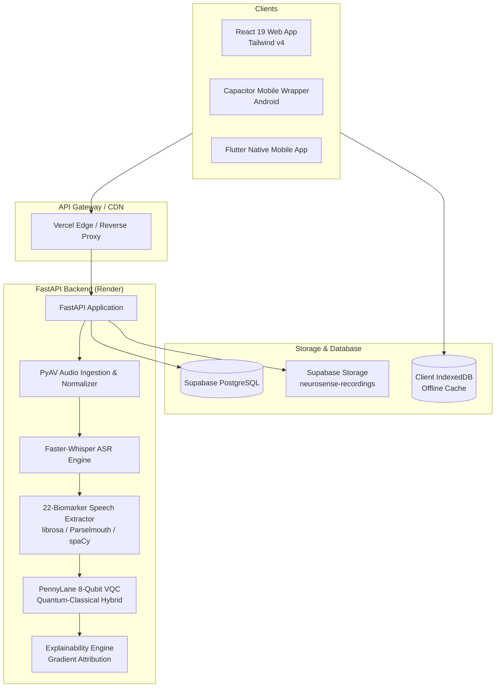

# NeuroSense (न्यूरोसेंस)

[](https://vitejs.dev/)
[](https://react.dev/)
[](https://tailwindcss.com/)
[](https://fastapi.tiangolo.com/)
[](https://pennylane.ai/)
[](https://flutter.dev/)
[](LICENSE)

> **NeuroSense** is an AI-powered neurological health monitoring and seizure detection platform. By combining multi-modal acoustic, speech, motor-stability biomarkers, and an 8-qubit Variational Quantum Circuit (VQC) hybrid neural network, NeuroSense provides accessible, non-invasive early neurological risk assessment for patients and clinical insights for healthcare professionals.

---

## 📑 Table of Contents

- [Overview & Clinical Focus](#overview--clinical-focus)
- [Key Features](#key-features)
- [🎭 Demo Studio (Hackathon & Evaluation Harness)](#-demo-studio-hackathon--evaluation-harness)
- [System Architecture](#system-architecture)
- [Quantum-Classical Hybrid Model](#quantum-classical-hybrid-model)
- [Repository Structure](#repository-structure)
- [Getting Started](#getting-started)
  - [Prerequisites](#prerequisites)
  - [Frontend Setup (Web & Desktop)](#frontend-setup-web--desktop)
  - [Backend Setup (FastAPI & Quantum Engine)](#backend-setup-fastapi--quantum-engine)
  - [Mobile App (Flutter)](#mobile-app-flutter)
  - [Android APK (Capacitor)](#android-apk-capacitor)
- [API Reference](#api-reference)
- [Testing & Verification](#testing--verification)
- [Deployment](#deployment)
- [Clinical & Regulatory Disclaimer](#clinical--regulatory-disclaimer)

---

## 🧠 Overview & Clinical Focus

Neurological disorders, including epilepsy, seizure events, and neurodegenerative conditions, often present subtle pre-ictal and sub-clinical manifestations in motor-speech stability, prosodic modulation, phonation jitter, and cognitive response latency long before acute episodes occur.

**NeuroSense** provides:
- **Patient-Centric Screening:** Engaging, non-intimidating vocal tasks and daily neurological check-ins designed for elderly individuals and patients at risk.
- **Multilingual Support:** Native user interfaces and acoustic normalization across 8+ languages (English, Hindi, Bengali, Marathi, Telugu, Tamil, Gujarati, Kannada).
- **Offline-First Resilience:** Client-side IndexedDB caching (`idb`), automated background sync queue, and local-first evaluation.
- **Doctor Clinical Hub:** Separate clinician portal for longitudinal tracking, motor-stability radar charts, clinical notes, and downloadable medical-grade PDF screening reports.

---

## ✨ Key Features

1. **Acoustic & Motor Biomarker Pipeline:**
   - Evaluates 22 clinical acoustic/speech features including fundamental frequency variation ($F_0$), jitter, shimmer, HNR, pause ratios, and phonetic articulation stability.
2. **Quantum-Classical Machine Learning:**
   - PyTorch classical encoder coupled with an 8-qubit PennyLane Variational Quantum Circuit (VQC) with `AngleEmbedding` and `BasicEntanglerLayers`.
   - Monte Carlo Dropout (30 stochastic forward passes) for uncertainty estimation and confidence calibration.
3. **Dual-Transport Screening Architecture:**
   - Asynchronous queue-based job processing (`POST /api/screenings`) to eliminate HTTP gateway timeouts on low-power devices.
   - Live stage tracking via Supabase Realtime WebSocket subscriptions with automated fallback to HTTP polling.
4. **Cognitive & Motor Engagement Activities:**
   - Interactive games for cognitive agility: Logic Puzzles, Memory Treasure, Selective Attention, and Speed Visualisation.
5. **Strict Patient vs. Doctor View Separation:**
   - Patient phone view is dedicated strictly to wellness routines, daily check-ins, and vocal exercises.
   - Doctor Clinical Dashboard is accessible exclusively through the clinician workstation interface.

---

## 🎭 Demo Studio (Hackathon & Evaluation Harness)

NeuroSense includes a dedicated, zero-mock **Demo Studio** for rapid hackathon judging, clinical presentations, and verification.

### Launching Demo Mode
Open the application with the `?demo=1` query parameter or set `VITE_DEMO_MODE=true`:
```
http://localhost:8443/?demo=1
```

### Key Capabilities
- **6 Realistic Fictional Personas:** Diverse demographics, regional languages (Kannada, Hindi, English), varying education levels (3 to 15 years), and cognitive trajectories (`lakshmi`, `ramesh`, `savitri`, `abdul`, `kamala`, `narayan`).
- **Live Animated Autofill:** Visual step-by-step form completion into the Family Setup Wizard with human-like typing cadence, field highlighting, and adjustable speeds (`Natural`, `Fast`, `Instant`).
- **Answer Source Selection:** In the voice session screen, choose between:
  - `Demo Audio (Default)`: Streams realistic regional voice audio into Faster-Whisper and acoustic feature extractors.
  - `Upload Audio`: Allows testing arbitrary external `.wav` / `.mp3` files.
  - `Microphone`: Standard browser microphone recording.
- **Pipeline Inspector:** Streaming diagnostic panel exposing live intermediate states:
  - Raw Audio & SNR (dB)
  - Faster-Whisper Multilingual ASR
  - 5-Layer Life Memory Match Engine Decision (Exact, Alias, Numeric, Fuzzy, Semantic)
  - Multi-stage retrieval credit (Free $\rightarrow$ Cued $\rightarrow$ Recognition)
  - Acoustic Biometrics (Jitter, Shimmer, Pitch Variance, Spectral Centroid)
  - Mathematical CSI Scoring formula with real numbers and SHA-256 configuration hash.
- **What-If Counterfactual Lab:** Test how changing safety hazards, SNR noise, or schooling years alters outcomes in real time, run automated determinism checks, and export JSON run traces.
- **Audio Overrides:** Place custom recordings in `demo/audio_override/<scenario_id>/<fact_id>_<stage>.wav` to override synthetic audio.

---

## 🏛 System Architecture



---

## ⚛ Quantum-Classical Hybrid Model

The machine learning engine leverages an 8-qubit Parameterized Quantum Circuit (PQC) integrated seamlessly into a classical PyTorch neural network:

- **Input Dimension:** 22 extracted speech and motor biomarkers.
- **Classical Encoder:** Dense linear layer reducing 22 biomarkers to an 8-dimensional latent vector ($22 \to 16 \to 8$).
- **Quantum Circuit (PennyLane):**
  - **Qubits:** 8 quantum wires.
  - **State Encoding:** `AngleEmbedding` with Y-axis rotation.
  - **Entanglement:** `BasicEntanglerLayers` (3 layers $\times$ 8 qubits, weight tensor shape $(3, 8)$).
  - **Measurement:** Expectation values $\langle Z_i \rangle$ across all 8 qubits.
- **Classical Decoder:** Dense output layer with residual skip-connection predicting neurological risk probability.
- **Uncertainty Quantification:** 30 Monte Carlo Dropout passes compute mean probability and epistemic uncertainty ($\sigma$). Predictions with high uncertainty are flagged for manual clinical evaluation.

---

## 📂 Repository Structure

```
NeuroSense/
├── android/                 # Capacitor Android native project (wraps web dist/)
├── backend/                 # FastAPI backend & Quantum ML engine
│   ├── database/            # Supabase SQL schemas and migrations
│   ├── models/              # Checkpoint weights, scalers, and feature metadata
│   ├── main.py              # FastAPI application endpoints
│   ├── model_loader.py      # Quantum-Classical Hybrid network loader
│   ├── screening_engine.py  # ASR and screening orchestration
│   ├── screening_jobs.py    # Background worker and async job queue
│   ├── speech_features.py   # 22 clinical acoustic feature extraction
│   └── explainability.py    # Quantum gradient attribution engine
├── mobile/                  # Native Flutter cross-platform mobile application
│   ├── lib/                 # Flutter source (screens, services, models)
│   └── test/                # Flutter unit and widget test suite
├── src/                     # React 19 web application
│   ├── components/          # Reusable UI, modals, and cognitive game components
│   ├── services/            # IndexedDB, Supabase, audio recording & API clients
│   ├── types/               # TypeScript definitions
│   └── App.tsx              # Main application shell and clinical dashboard
├── package.json             # Root web project configuration (pnpm)
├── vite.config.ts           # Vite + Tailwind v4 configuration
└── README.md                # Project documentation
```

---

## 🚀 Getting Started

### Prerequisites

- **Node.js**: v18.0.0 or higher
- **pnpm**: v9.0.0 or higher (`npm install -g pnpm`)
- **Python**: 3.10 or 3.11
- **Flutter**: 3.3.0+ (optional, for native mobile client)

### Frontend Setup (Web & Desktop)

1. **Install dependencies:**
   ```bash
   npm install
   ```

2. **Start the development server:**
   ```bash
   npm run dev
   ```
   The application runs at `http://localhost:8443`.

3. **Build for production:**
   ```bash
   npm run build
   ```

### Backend Setup (FastAPI & Quantum Engine)

1. **Create and activate a virtual environment:**
   ```bash
   cd backend
   python -m venv .venv
   # Windows:
   .venv\Scripts\activate
   # macOS/Linux:
   source .venv/bin/activate
   ```

2. **Install Python dependencies:**
   ```bash
   pip install -r requirements.txt
   ```

3. **Configure Environment Variables:**
   Create a `.env` file in `backend/` (or copy from `.env.example`):
   ```env
   NEUROSENSE_WHISPER_MODEL=tiny
   NEUROSENSE_JOB_WORKERS=1
   SUPABASE_URL=https://your-project.supabase.co
   SUPABASE_ANON_KEY=your-anon-key
   SUPABASE_SERVICE_ROLE_KEY=your-service-role-key
   ```

4. **Run the FastAPI server:**
   ```bash
   python main.py
   ```
   The backend will start at `http://127.0.0.1:8001`. Interactive OpenAPI documentation is accessible at `http://127.0.0.1:8001/docs`.

### Mobile App (Flutter)

```bash
cd mobile
flutter pub get
flutter run
```

### Android APK (Capacitor)

The repository includes a Capacitor wrapper configured under application ID `org.neurosense.app`.
```bash
npm run build
npx cap sync android
npx cap open android
```

---

## 📡 API Reference

| Method | Endpoint | Description |
|---|---|---|
| `GET` | `/api/health` | System health, model architecture, and runtime status |
| `POST` | `/api/screenings` | Upload audio and initiate asynchronous screening job (`202 Accepted`) |
| `GET` | `/api/screenings/{id}` | Poll screening progress, biomarker outputs, and quantum risk score |
| `POST` | `/api/analyze-audio` | Synchronous audio evaluation (for short diagnostic clips and testing) |
| `GET` | `/api/model/info` | Detailed quantum model architecture, feature weights, and evaluation metrics |

---

## 🧪 Testing & Verification

### Web & TypeScript Verification
```bash
# Typecheck
npx tsc --noEmit

# Format verification
npx oxfmt src

# Production build test
npm run build
```

### Backend Test Scripts
```bash
python backend/test_model_loader.py
python backend/test_screening_engine.py
python backend/test_api_analyze.py
```

### Flutter Test Suite
```bash
cd mobile
flutter test
```

---

## 🌐 Deployment

- **Web Client:** Hosted on **Vercel** with automatic rewrite proxying `/api/*` to the backend.
- **Backend API:** Containerized Docker deployment on **Render** (CPU-optimized, low-memory footprint using `int8` quantization for Whisper).
- **Database & Storage:** Managed **Supabase** instance storing records in `recordings` and encrypted audio files in `neurosense-recordings`.

---

## 👨‍💻 Author & Maintainer

**Saket Kumar** ([@Saket207](https://github.com/Saket207))
- **GitHub:** [https://github.com/Saket207](https://github.com/Saket207)
- **Repository:** [https://github.com/Saket207/NeuroSense](https://github.com/Saket207/NeuroSense)
- **Contact:** saketk207@gmail.com

---

## ⚖ Clinical & Regulatory Disclaimer

> **Important Medical Notice:**
> NeuroSense is an experimental AI-assisted neurological screening and research tool designed to identify speech and motor-stability biomarker variations.
>
> **NeuroSense is NOT a diagnostic medical device** and is not certified to diagnose, treat, cure, or prevent any neurological disease, including epilepsy or Alzheimer's.
>
> Screening scores represent statistical risk probabilities calculated by machine learning models and must **always** be reviewed by a certified neurologist or healthcare professional alongside comprehensive clinical assessments, neurological examinations, and EEG studies.
